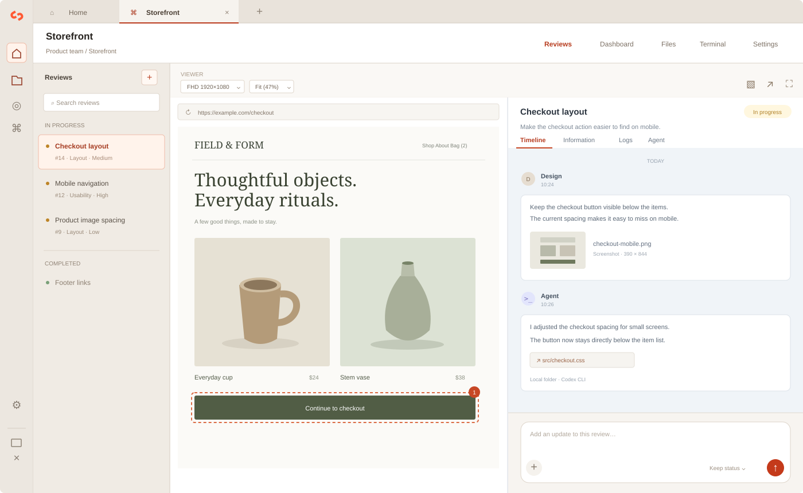

<p align="center"></p>

<h1 align="center">ReviewOps</h1>

<p align="center">From review to resolution.<br>A desktop workspace for project reviews, screenshots, files, and Codex tasks.</p>

<p align="center"><a href="https://season-framework.github.io/reviewops-local/">Website</a> · <a href="https://github.com/season-framework/reviewops-local/releases/latest">Download</a> · <a href="docs/guide-ko.md">한국어 안내</a> · <a href="CONTRIBUTING.md">Contributing</a></p>



*Illustrative interface with sample data. No real project or account data is shown.*

ReviewOps brings a website viewer, review conversations, attachments, and agent tasks into one desktop app. Organize projects inside groups and connect each project to a local folder or a saved SSH host. Review data is stored on your computer. No ReviewOps server or ReviewOps login is required.

## Features

- **Groups and projects:** organize reviews, labels, priorities, and progress. Keep project connection, viewer, and agent settings together.
- **Website viewer:** open external websites in a dedicated browser view with persistent sessions. Switch between 4K, FHD, HD, tablet, mobile, and custom sizes.
- **Reviews and timeline:** capture screenshots, attach files and browser logs, and keep discussion and task results together. Export a review's instructions and attachments as a ZIP.
- **Codex tasks:** run Codex CLI in a local folder or directly on an SSH host. Send instructions, screenshots, logs, and files; continue a conversation; open generated files from the original working directory.
- **Account and host management:** manage separate Codex account profiles and usage information. Reuse SSH hosts from your SSH configuration, browse remote files, and manage Codex on a host.
- **Languages and accessible controls:** choose an interface language in Settings. Search long dropdown lists and use arrow keys, Enter, and Escape.
- **Local storage and updates:** store reviews in SQLite and attachments in files, export project backups, and download compatible app updates from GitHub Releases.

The core interface supports **English, Korean, Japanese, Simplified Chinese, Traditional Chinese, Spanish, French, German, Brazilian Portuguese, Italian, Russian, and Vietnamese**. Some advanced technical messages use an English fallback. Content you write and external websites are not translated.

## Install

Supports **macOS 13 or later** and **Windows 10/11 x64**. Linux installers are not provided.

### Windows

1. Open the [latest release](https://github.com/season-framework/reviewops-local/releases/latest).
2. Download `ReviewOps-<version>-windows-x64.exe`.
3. Run the installer and choose an installation folder. Installation applies to your Windows account.
4. Open ReviewOps from the Start menu or desktop shortcut.

The Windows installer is unsigned. Project data is kept when updating or uninstalling the app.

### macOS

1. Open the [latest release](https://github.com/season-framework/reviewops-local/releases/latest).
2. Download the `.dmg` matching your Mac: **arm64** for Apple Silicon or **x64** for Intel. You can find your chip in **Apple menu → About This Mac**.
3. Open the DMG and drag **ReviewOps** into **Applications**.
4. Open ReviewOps from Applications.

Release builds are ad hoc signed and are **not Apple-notarized**. If macOS blocks the first launch, follow [Apple's instructions for opening an app from an unidentified developer](https://support.apple.com/en-us/102445). Do not disable Gatekeeper system-wide.

Each release includes SHA-256 checksums. To check a Windows installer in PowerShell:

```powershell
Get-FileHash .\ReviewOps-1.2.8-windows-x64.exe -Algorithm SHA256
```

To check a macOS installer:

```sh
shasum -a 256 ReviewOps-1.2.8-arm64.dmg
```

Compare the result with the checksum published in that release.

## Start a project

1. Open **Groups** and create a group.
2. Create a project inside the group.
3. Choose a **local folder** or a saved **SSH host** and working directory. Register SSH hosts in the sidebar first.
4. Set the website address and viewer preferences in the project's settings.
5. Open **Reviews**, create a review, and add the description, screenshots, logs, or files.
6. Use the review timeline to record progress, or the **Agent** panel to start a Codex task.

Drag the logo or an empty area of the tab bar to move the window. The Home tab stays fixed; other workspace tabs can be reordered by dragging or with **Alt+Shift+←/→**.

### Using Codex

Codex CLI must be installed and signed in on the computer where a task will run. Local projects use Codex on your computer; SSH projects use Codex on the selected host. Configure the executable, model, reasoning level, and instructions in **Project → Settings → Agent**.

The app collects models, supported reasoning levels, and defaults from your computer and saved SSH hosts at startup and every hour by default. Review agents read the saved catalog immediately without connecting to the host again. Host management shows each catalog, its last collection time, and a refresh action. Failed collection keeps the last successful catalog. Change the interval in **Settings → Automatic checks**. If no saved catalog is available, register models and their reasoning levels in **Project → Settings → Agent → Register models**. Registered models are saved with the project connection and included in backups.

The first accepted request in a review includes the selected instructions, screenshot, and logs automatically. After that, requests send only the entered text unless you explicitly add materials. Model collection failures remain visible in Settings; the review agent continues using saved choices without a collection-failure notice.

Agent commands run as:

```sh
codex exec --dangerously-bypass-approvals-and-sandbox
```

Tasks have the permissions of the selected local or SSH account. ReviewOps does not add an execution sandbox or approval layer. Use a project folder and account appropriate for the task. Starting an agent task changes the review status to **In progress**.

Codex account profiles in ReviewOps are separate from the default Codex login. Account import is explicit and preserves the source app's data. File-based credentials can be copied; credentials stored only in macOS Keychain require signing in again. ReviewOps does not use Keychain.

### Requests from external tools

The [ReviewOps skill](skills/reviewops/SKILL.md) provides a local JSON command for tools that can run Node.js, including Codex, Claude Code, and Hermes. Requests specify a project ID or an exact local working folder. Each project opens in its own window; later requests reuse that project’s window. The command registers a review and opens it without starting an agent. See [the request commands](docs/tool-integration.md) for setup and examples.

### Using SSH

Host management reads `~/.ssh/config` and its included files, including `IdentityFile` and `ProxyJump`. Registered hosts can be selected by multiple projects. The app checks host keys and does not accept an unknown or changed key automatically. On macOS, its SSH commands use `UseKeychain=no`. Windows host management uses SSH keys; password prompts are not supported there.

Host file management supports browsing, preview, upload, download, rename, move, and delete. The project terminal is available for SSH connections.

## Data and privacy

ReviewOps stores project and review data under:

| Platform | Data folder |
| --- | --- |
| macOS | `~/Library/Application Support/ReviewOps Local/` |
| Windows | `%APPDATA%\ReviewOps Local\` |

The historic folder name is retained so existing installations keep their data.

| Location | Contents |
| --- | --- |
| `reviewops.sqlite` | Groups, projects, connections, reviews, timeline, logs, agent runs, attachment records |
| `attachments/` | Review and timeline attachments |
| `codex-manager/` | Account profiles, cached usage and statistics, import records, executable settings |
| `credentials.json` and `credentials.json.key` | Encrypted credentials for legacy direct SSH connections |
| `recovery/` | Copies made before restoration or migration |
| `Partitions/` | Website cookies and browser storage |

The app does not need a hosted ReviewOps backend. External websites, SSH connections, Codex, account usage requests, and update checks use their respective network services. Instructions and selected attachments are sent to the Codex environment when you start an agent task.

Use **Settings → Save backup file** to export a JSON backup containing project data and attachments. This backup does **not** contain SSH passwords, key passphrases, Codex credentials, or website cookies. To archive the entire installation's data, quit ReviewOps first and copy the application data folder. Keep any backup containing credentials private.

Deleting a group removes its projects, reviews, history, and attachments. Deleting a project removes its review data and connection settings. The confirmation requires the group's or project's name. Saved SSH hosts and Codex accounts are managed separately.

## Updates

On macOS, ReviewOps checks public [GitHub Releases](https://github.com/season-framework/reviewops-local/releases) immediately at startup and every ten minutes by default while the app is running, when automatic checks are enabled. Change the interval in **Settings → Automatic checks**. No GitHub account or token is needed in the app. An update notification appears at the bottom of the sidebar. Select it to download, verify, install, and restart in one action. The same action is available in Settings. Enabling automatic checks also checks immediately.

The updater selects the build for your Mac, checks its declared size and SHA-256 hash, verifies the app bundle, and replaces the application before restarting. Project data is kept outside the application bundle. SSH agent tasks continue on the server while the app restarts, and the app reconnects to their output. Local tasks, terminal sessions, login operations, and file transfers must finish before installation. Remote agent execution requires Linux with bash, nohup, and setsid. The website is an introduction and download page; the update feed comes directly from GitHub Releases.

On Windows, download the newer Windows installer from GitHub Releases, close ReviewOps, and run the installer again. Project data is stored separately and retained. Windows does not yet support installation through the in-app updater. The optional Season AI connection is available on macOS only.

## Development

Use **Node.js 24 or later** and npm on macOS or Windows. Build each installer on its matching operating system.

```sh
git clone https://github.com/season-framework/reviewops-local.git
cd reviewops-local
npm ci
npm run dev
```

Build and run checks:

```sh
npm run build
npm test
npm run test:selects
npm run test:project-connections
npm run test:account-import
```

Tests use temporary app data and synthetic CLI responses. They must not consume real account credits, change remote systems, or overwrite a user's Codex login. See [CONTRIBUTING.md](CONTRIBUTING.md).

Create installers:

```sh
npm run package
npm run package:intel
# Run on Windows:
npm run package:windows
```

Build output is written to `release/`. The [release guide](docs/releasing.md) covers update ZIPs, checksums, release publication, and GitHub Pages deployment.

| Folder | Purpose |
| --- | --- |
| `src/` | React interface and styles |
| `electron/` | Local database, IPC, browser, SSH, Codex, and updater |
| `tests/` | Unit and integration tests |
| `scripts/` | Development, build, release, and UI test tools |
| `website/` | Static GitHub Pages introduction site |
| `docs/` | User and contributor documentation |

## Contributing and support

Report reproducible problems in [Issues](https://github.com/season-framework/reviewops-local/issues). Include the app version, operating system version, processor type, steps, and a sanitized screenshot or log. Never include tokens, private keys, account credentials, or real project attachments.

For vulnerabilities, follow [SECURITY.md](SECURITY.md). Pull requests are welcome; see [CONTRIBUTING.md](CONTRIBUTING.md).

## License

ReviewOps source code is available under the [MIT License](LICENSE). Third-party libraries, fonts, icons, and Electron components retain their respective licenses. See [NOTICE](NOTICE), [THIRD-PARTY-NOTICES.txt](THIRD-PARTY-NOTICES.txt), and the [licensing notes](docs/licensing.md).

ReviewOps is an independent project and is not affiliated with or endorsed by OpenAI. Codex is a product of OpenAI.
